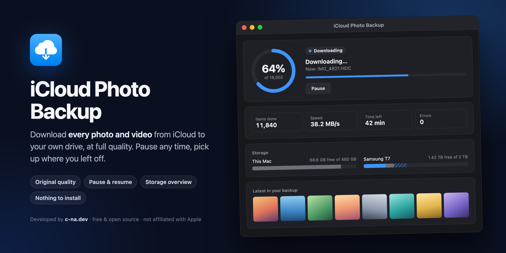

# iCloud Photo Backup



[](https://github.com/sina-developer/icloud-photo-backup/releases/latest)
[](https://github.com/sina-developer/icloud-photo-backup/actions/workflows/ci.yml)
[](LICENSE)


A simple Mac app that downloads **every photo and video in your iCloud Photos library** to a
folder you choose, for example on an external SSD, at full original quality.

Useful when you're cancelling your iCloud storage plan, or just want your own copy of your
library. It uses the proven open-source downloader [icloudpd] underneath, with a friendly
window on top. No Terminal or extra installs needed.

Developed by **[c-na.dev](https://c-na.dev)**.

> Not affiliated with Apple. iCloud is a trademark of Apple Inc.

## Features

- **Full-quality originals:** HEIC/JPEG/RAW photos, videos and Live Photo videos.
- **Pause and resume:** stop any time and continue later, even after a restart. Files already
  downloaded are skipped, and half-finished files continue where they stopped.
- **Survives hiccups:** retries automatically when the connection drops, and keeps the Mac
  awake while downloading.
- **See what's happening:** progress, speed, time left and previews of the latest photos.
- **Storage overview:** bars for your Mac's disk and the backup drive, the backup's size, an
  estimate of the whole library's size, and a warning if it won't fit.
- **Self-contained:** Python and icloudpd are bundled inside the app.
- **Private:** talks only to Apple. Your password is kept in memory, never saved.

## Requirements

- A Mac with an Apple chip (M1 or newer), running macOS 12 Monterey or later.
- An Apple ID with iCloud Photos turned on.
- If **Advanced Data Protection** is on: turn on *Settings → [your name] → iCloud →
  Access iCloud Data on the Web* on your iPhone, and tick the matching option in the app.

## Install

1. Download `iCloud-Photo-Backup-<version>-arm64.dmg` from the
   [latest release](https://github.com/sina-developer/icloud-photo-backup/releases/latest).
2. Open the DMG and drag **iCloud Photo Backup** into **Applications**.
3. The app isn't notarized by Apple, so the first time you open it macOS will block it.
   Go to **System Settings → Privacy & Security**, scroll down and click **Open Anyway**.

If macOS says the app **"is damaged"** or still won't open it, run this in Terminal:

```bash
xattr -dr com.apple.quarantine "/Applications/iCloud Photo Backup.app"
```

You can check the download against the `.sha256` file on the release page:

```bash
shasum -a 256 -c iCloud-Photo-Backup-*.dmg.sha256
```

## How to use

1. Plug in your SSD and open the app.
2. Enter your Apple ID and password, and click **Choose…** to pick a folder on the SSD.
3. Click **Start backup** and enter the 6-digit code that appears on your Apple device.
4. Use **Pause** and **Resume** whenever you like. When it says **Backup complete**, compare the
   number of items with the count in the Photos app before deleting anything from iCloud.

Photos are saved in `Year/Month/Day` folders by default (configurable).

### Limitations

- Shared albums aren't downloaded (a limitation of icloudpd).
- The whole-library size is an estimate, based on the average size of the files downloaded so far.
- Intel Macs aren't supported by the release builds.

## Security and privacy

- **Password:** kept in memory while the app is open, and passed only to icloudpd, which signs
  in with Apple. It is never written to disk or logged.
- **Local only:** the app's interface is served on `127.0.0.1` with a random per-launch token,
  so other devices and websites can't control it.
- **Saved sign-in:** after you sign in, icloudpd stores a session token in `~/.pyicloud`
  (usually valid for about two months) so you don't need a new code every time.
- **Previews:** small preview images are cached in
  `~/Library/Application Support/iCloudPhotoBackup/thumbs`.
- **Encryption:** for a private backup, format the SSD as **APFS (Encrypted)** in Disk Utility
  *before* you start. Formatting erases the drive.

When you're finished, remove the saved sign-in and the app's data:

```bash
rm -rf ~/.pyicloud ~/Library/Application\ Support/iCloudPhotoBackup
```

See [SECURITY.md](SECURITY.md) to report a vulnerability.

## Troubleshooting

- **"The backup engine stopped unexpectedly":** see the log with
  `tail -50 ~/Library/Application\ Support/iCloudPhotoBackup/app.log`.
- **Sign-in keeps failing:** check the password, then delete the saved session
  (`rm -rf ~/.pyicloud`) and try again.
- **"Bad CPU type in executable":** the Mac has an Intel chip, which isn't supported.
- **Something else:** expand **Activity log** at the bottom of the window, and include it
  (without personal details) in an [issue](https://github.com/sina-developer/icloud-photo-backup/issues).

## Build from source

You need Xcode (or the Command Line Tools) and Python 3.10 or newer.

```bash
git clone https://github.com/sina-developer/icloud-photo-backup.git
cd icloud-photo-backup
scripts/build.sh
```

This creates `dist/iCloud Photo Backup.app` and `dist/iCloud-Photo-Backup-<version>-arm64.dmg`.
Set `PYTHON=/path/to/python3` to choose which Python creates the build environment.

To work on the interface without building, install icloudpd (`brew install icloudpd`) and run:

```bash
python3 app/server.py
```

This opens the same interface in your browser.

### How it works

| Part | File | Role |
| --- | --- | --- |
| App window | `app/main.swift` | Native Cocoa window that starts the engine and shows the interface in WebKit |
| Engine | `app/server.py` | Local server that runs icloudpd in a pseudo-terminal, answers its prompts and tracks progress |
| Interface | `app/index.html` | Progress, controls, storage and previews |
| Downloader | icloudpd | Bundled standalone binary from the official PyPI wheel |

## Releases and versioning

The project follows [Semantic Versioning](https://semver.org/). The current version is in
[`VERSION`](VERSION) and changes are listed in [`CHANGELOG.md`](CHANGELOG.md).

To make a release:

1. Add your notes under `## [Unreleased]` in `CHANGELOG.md` and commit them.
2. Run `scripts/release.sh X.Y.Z`. It updates `VERSION` and the changelog, commits and tags `vX.Y.Z`.
3. Run `git push && git push origin vX.Y.Z`.

GitHub Actions then builds the DMG and publishes a GitHub Release with the changelog notes and
a SHA-256 checksum.

## Contributing

Contributions are welcome. See [CONTRIBUTING.md](CONTRIBUTING.md).

## License

[MIT](LICENSE). Bundled third-party software is listed in
[THIRD_PARTY_NOTICES.md](THIRD_PARTY_NOTICES.md).

## Credits

Developed by **[c-na.dev](https://c-na.dev)**. Downloading is powered by [icloudpd], by its
open-source contributors.

[icloudpd]: https://github.com/icloud-photos-downloader/icloud_photos_downloader
